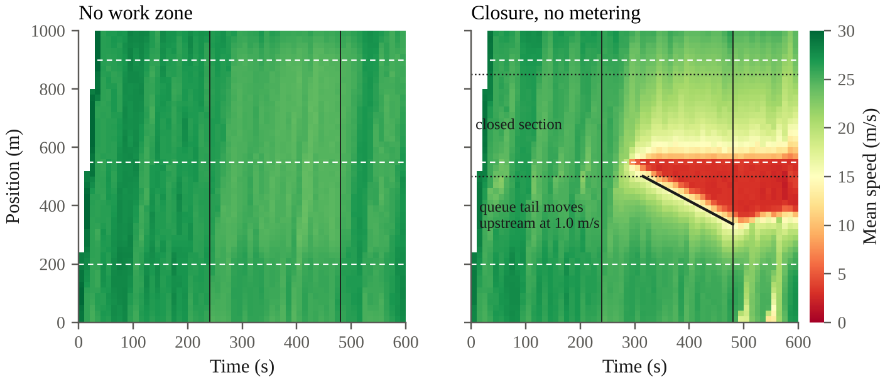
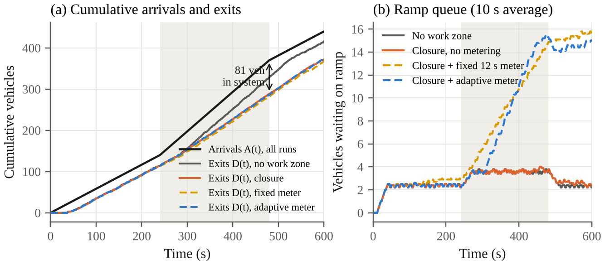
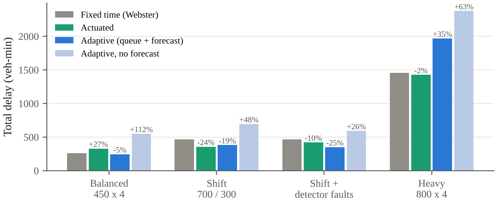

# CEE C181/C281 Design Project: Detector-Based Traffic Control

Simulation and detector-based control experiments on one shared Intelligent Driver Model (IDM):

1. **Freeway work zone.** A 1 km, three-lane freeway with a left-lane closure (500 to 850 m), an on-ramp at 250 m and a ramp meter. The meter sees only 30 s detector counts.
2. **Signalized intersection (Pathway B).** Four 300 m approaches and two phases. Four controllers are compared on identical arrivals: Webster fixed time, actuated, adaptive (queue + forecast pressure), and adaptive without the forecast (ablation).

In both environments the controller never reads the simulated state. It estimates the state from detector reports, forecasts the next interval, and then acts.

**Authors:** Jiageng Liu (CEE C281) and Nasser Alsowyan (CEE C181)

---

## Quick start

Python 3.9+ and `matplotlib` are the only requirements. Run every command from the repository root.

    pip install matplotlib
    python3 run.py check all              # verification suite, about 1.5 min
    python3 run.py freeway                # 5 freeway runs, about 30 s
    python3 run.py intersection           # 16 intersection runs, about 50 s
    python3 tools/make_report_figures.py  # report figures 1-8 and quoted numbers

---

## Key results

| | |
|---|---|
|  | **The closure creates a queue that outlasts the peak.** Without the work zone, speeds stay above 20 m/s. With the left lane closed, a low-speed region forms at the taper at about 300 s and its tail moves upstream at about 1 m/s. |
|  | **Ramp metering moves the queue but does not shrink it.** The exit curves of all three closure runs coincide, so the bottleneck discharges the same flow with or without metering. Metering only moves vehicles from the mainline to the ramp. |
|  | **Responsive control wins when demand shifts and loses when the intersection is saturated.** Actuated and adaptive control cut delay by 24% and 19% under the directional shift. Adaptive control is 35% worse than fixed time under heavy demand. |

---

## Reproducing the mid-report

`python3 run.py freeway` and `python3 run.py intersection` write all raw outputs to `results/`. `python3 tools/make_report_figures.py` reads those outputs, writes the figures below to `results/figures/report/`, and writes every number quoted in the report to `results/figures/report/report_numbers.json`. It never re-runs a simulation.

| Report item | Source file | Produced by |
|---|---|---|
| Fig. 1, layout of both environments | `results/figures/report/fig01_layout.png` | `tools/make_report_figures.py` |
| Fig. 2, freeway speed contour | `results/figures/report/fig02_speed_contour.png` | `tools/make_report_figures.py` |
| Fig. 3, flow-density diagram | `results/figures/report/fig03_fundamental_diagram.png` | `tools/make_report_figures.py` |
| Fig. 4, cumulative curves and ramp queue | `results/figures/report/fig04_cumulative_curves.png` | `tools/make_report_figures.py` |
| Fig. 5, estimate vs. hidden state | `results/figures/report/fig05_estimate_vs_truth.png` | `tools/make_report_figures.py` |
| Fig. 6, intersection delay | `results/figures/report/fig06_intersection_delay.png` | `tools/make_report_figures.py` |
| Fig. 7, adaptive phases, directional shift | `results/figures/report/fig07_phase_timeline_shift.png` | `tools/make_report_figures.py` |
| Fig. 8, adaptive phases, heavy demand | `results/figures/report/fig08_phase_timeline_heavy.png` | `tools/make_report_figures.py` |
| Freeway results table | `results/freeway/summary.csv`, `results/freeway/experiment_report.md` | `python3 run.py freeway` |
| Intersection results table | `results/intersection/summary.csv`, `results/intersection/experiment_report.md` | `python3 run.py intersection` |
| Verification claims | `results/freeway/verification.json`, `results/intersection/verification.json` | `python3 run.py check all` |

The freeway sensitivity runs (heavy demand, homogeneous drivers, merge at the taper, no forecast, Δt halved) use the configs in `freeway/configs/`. See `freeway/README.md` for the commands.

---

## Repository structure

- `freeway/`: IDM freeway simulation with the work-zone closure, on-ramp merging, loop and boundary detectors, count-conservation estimation, forecasting and ramp metering. See `freeway/README.md`.
- `intersection/`: Signalized intersection on the same IDM vehicle model, with advance and stop-line loops, queue estimation, arrival forecasting and the four controllers. See `intersection/README.md`.
- `run.py`: Single entry point for simulations and verification checks.
- `tools/make_report_figures.py`: English report figures and quoted numbers (above).
- `tools/make_figures.py`: The earlier quick-look figure script (labels in Chinese), kept for reference.
- `results/`: Experiment data, metrics, logs, summary reports and figures.
- `docs/`: Course documents and design records (`docs/design_record_review3.md`).
- `view.html`, `freeway.html`, `intersection.html`: Interactive viewers (see below). The `.html.in` files are templates and cannot be opened directly.

---

## Verification

`python3 run.py check all` runs the following checks across both environments:

- Vehicle conservation at every step.
- Trajectory audits: no overlaps, negative speeds, closed-lane entries, red-light runs, or simultaneous conflict-box occupancy.
- Detector counts compared against counts recomputed from trajectories.
- Single-vehicle IDM tests.
- A time-step halving test.

Use `python3 run.py check freeway` or `python3 run.py check intersection` to run one environment.

---

## Interactive viewers

`freeway.html` and `intersection.html` replay the simulations, with true versus estimated queues, the signal phase timeline, controller decisions at every step, and the controller comparison table. `view.html` links to both pages. Each page embeds its own data and needs no server.

**GitHub shows `.html` files as source code instead of running them.** To use a viewer, download the repository (green **Code** button, then **Download ZIP**), unzip it, and double-click `freeway.html` or `intersection.html`.
